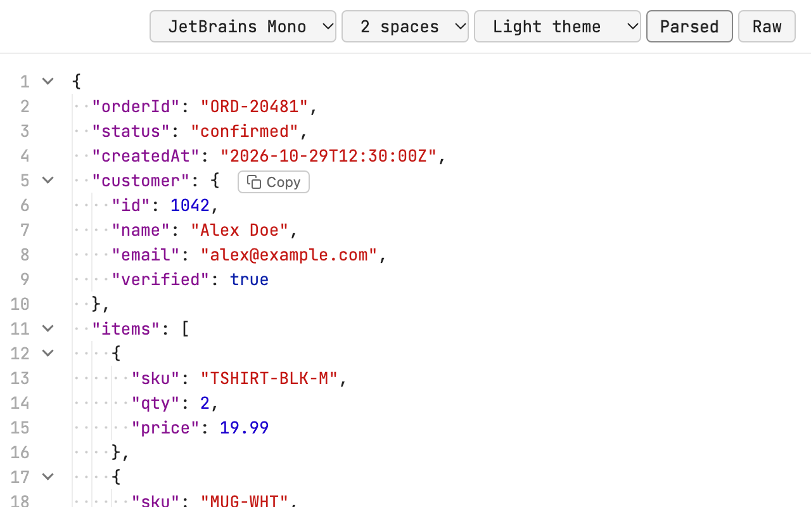
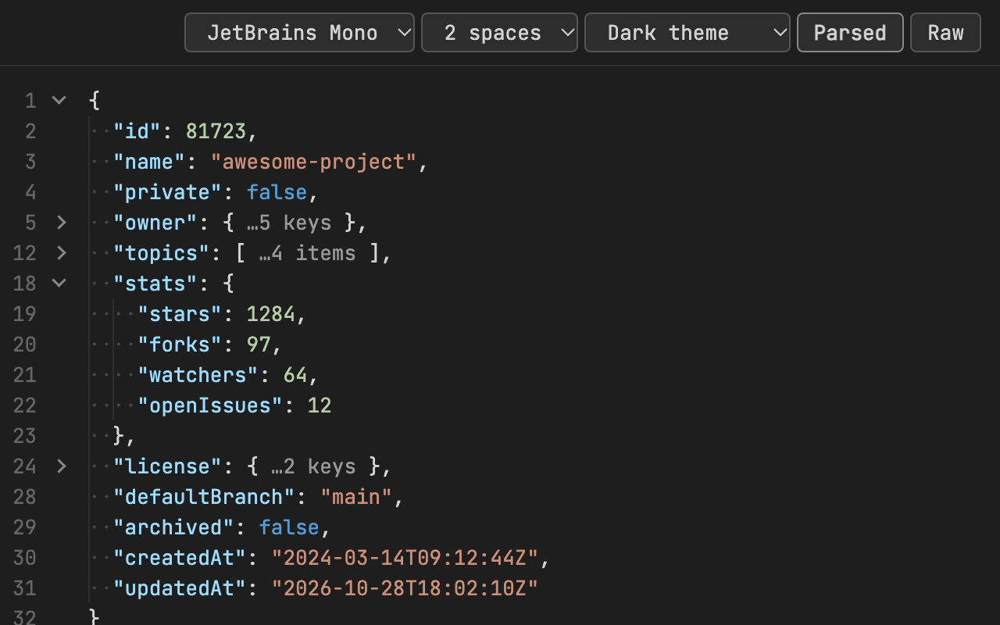
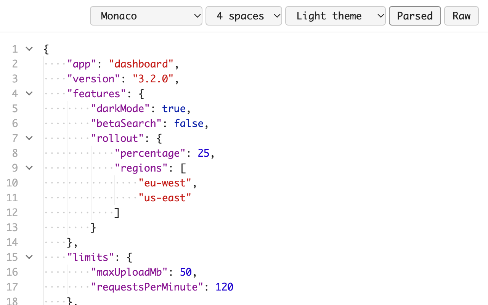
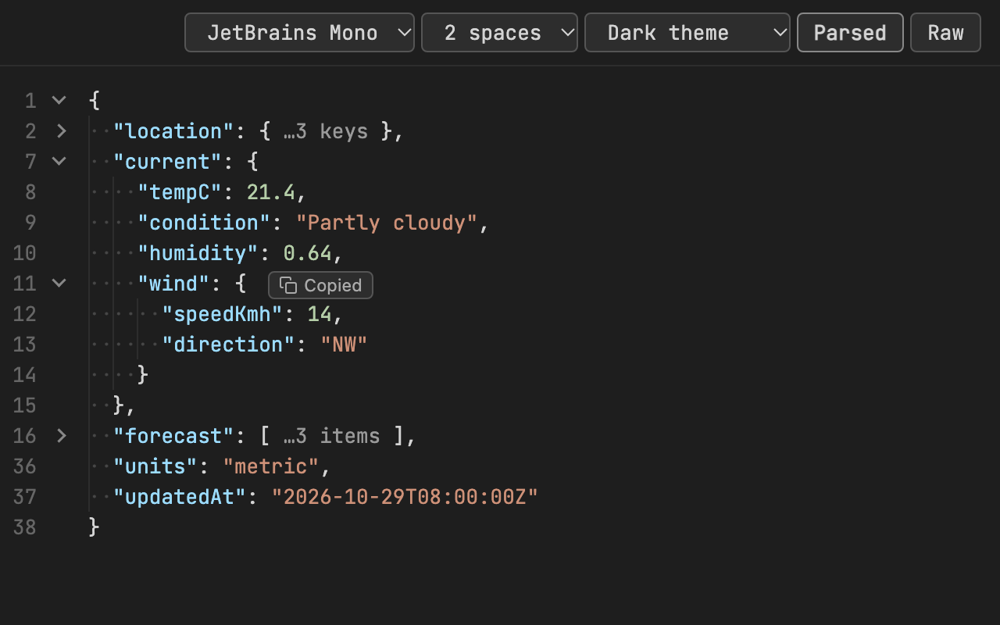
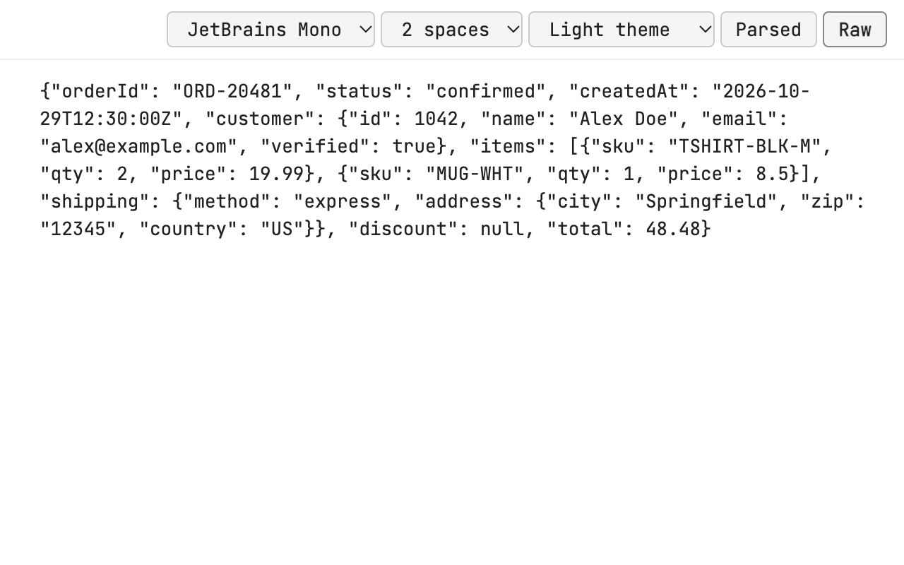

#  Brace – JSON Viewer

A Chrome extension that shows JSON the way your IDE does: clean indentation, indent guides, line numbers, collapsible sections and one-click copy. Everything runs locally in your browser.

## Features

- **Indent of your choice**: 2 spaces (default) or 4 spaces
- **IDE-style indent guides**: vertical guide lines plus faint dots for each indent space
- **Line numbers** that keep their original values when you collapse sections
- **Collapse and expand** any object or array; collapsed sections show how many items or keys they hold
- **One-click copy**: hover over any object or array and click Copy to put it on your clipboard, formatted with your chosen indent
- **Colour highlighting** for keys, strings, numbers, booleans and null
- **Light, Dark or System theme** (follows your OS by default)
- **Font choice**: JetBrains Mono (bundled), or Monaco and Menlo on macOS
- **Parsed / Raw** toggle
- Settings are saved and sync across your Chrome browsers

## Screenshots

| | |
|---|---|
|  |  |
| Dark theme, collapsed sections | 4-space indents, Monaco font |
|  |  |
| One-click copy | Raw view |

## Install from source

1. Clone this repo.
2. Open `chrome://extensions` and turn on **Developer mode**.
3. Click **Load unpacked** and select the cloned folder.
4. Turn off any other JSON formatter extension so the two don't conflict.
5. Optional: to format local `.json` files, open the extension's **Details** and turn on **Allow access to file URLs**.

## Privacy

Brace collects no data and makes no network requests. See the [privacy policy](https://hrithikvish.github.io/brace-json-viewer/privacy-policy.html).

## Credits

[JetBrains Mono](https://github.com/JetBrains/JetBrainsMono) is bundled under the SIL Open Font License 1.1 (see [`OFL.txt`](OFL.txt)).
